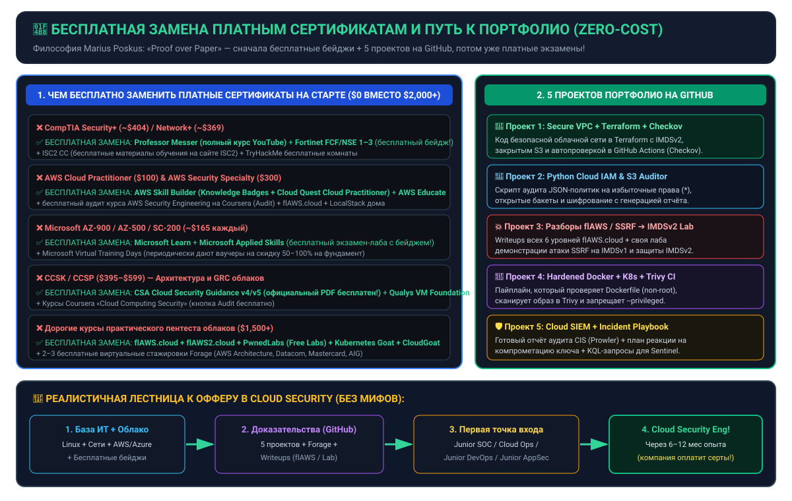

# 💸🎓 Бесплатная Замена Сертификатов ($0 вместо $2,000+)

> **Важное правило курса:** На старте **НЕ трать деньги** на платные экзамены ($100–$600 каждый). По методике CISO Marius Poskus и UnixGuy:
> 1. Сначала получи **фундаментальные знания + бесплатные подтверждённые бейджи** + **5 проектов на GitHub**.
> 2. Устройся на первую работу (Junior SOC / Cloud Ops / DevSecOps / Junior CloudSec).
> 3. **Пусть твой будущий работодатель сам оплатит тебе дорогой сертификат** (AWS Security Specialty, AZ-500, CCSP и т.д.) — в 80% компаний есть бюджет на обучение!

---

## 🔄 Таблица: Платный сертификат ➔ Что взять ВМЕСТО него за $0

| Платный сертификат (Игнорируем сейчас) | Цена экзамена | ✅ Бесплатная замена (Знания + Официальный бейдж / Сертификат за $0) | Что даст в резюме |
| :--- | :---: | :--- | :--- |
| **CompTIA Network+** & **Security+** | ~$369 + ~$404 | 1. Полные бесплатные видеокурсы **Professor Messer** на YouTube. 2. **Fortinet Training Institute — FCF / FCA (NSE 1–3)**: бесплатная регистрация, курсы и бесплатные онлайн-экзамены с цифровыми бейджами! 3. Бесплатные материалы обучения **ISC2 CC** (самоучитель на сайте ISC2 без оплаты экзамена). | Прочный фундамент сетей, портов, криптографии + официальные бейджи **Fortinet** для резюме. |
| **AWS Certified Cloud Practitioner (CLF-C02)** | $100 | 1. **AWS Educate** (полностью без карты!) — базовые курсы и бейджи. 2. **AWS Skill Builder — Knowledge Badges** (бесплатные оценки и бейджи Credly!) + игра **AWS Cloud Quest: Cloud Practitioner** (бесплатная в браузере!). | Настоящие цифровые бейджи **Amazon Web Services** на LinkedIn и практика в облачном 3D-симуляторе! |
| **AWS Certified Security – Specialty (SCS-C02)** | $300 | 1. **AWS Skill Builder — Security Learning Plan** + **AWS Security Knowledge Badge**. 2. Курсы от AWS на Coursera (кнопка **Audit** бесплатно!). 3. Полное прохождение **`flAWS.cloud` + `flAWS2.cloud`** + наш проект с **LocalStack & Terraform**. | Практическое понимание IAM, KMS, CloudTrail, GuardDuty и реальных атак, которое проверяют на собеседовании. |
| **Microsoft AZ-900 / SC-900 / AZ-500 / SC-200** | $99–$165 каждый | 1. **Microsoft Learn** — все официальные учебники и песочницы бесплатны. 2. **Microsoft Applied Skills** — бесплатные практические лабы-экзамены прямо в браузере с выдачей официального подтверждённого бейджа Microsoft! 3. **Microsoft Virtual Training Days** (иногда дают ваучеры/скидки на фундамент). | Практический бейдж от Microsoft (напр., *Configure SIEM security operations using Microsoft Sentinel*) — ценится выше голой теории! |
| **ISC2 CCSP / CSA CCSK** (Облачный GRC) | $395–$599 | 1. **CSA Security Guidance v4 / v5** — официальная библия облачной безопасности (PDF полностью бесплатен). 2. **Qualys Vulnerability Management Foundation** (бесплатный официальный PDF-сертификат вендора). 3. Курсы **Cloud Computing Security** (Univ. of Colorado) на Coursera через **Audit**. | Глубокое знание управления облачными рисками, GRC, аудита и управления уязвимостями. |
| **Платные лабы пентеста облака (SANS SEC510 / Bootcamps)** | $1,500–$8,000 | 1. **`flAWS.cloud`** и **`flAWS2.cloud`** (полностью бесплатно). 2. **`PwnedLabs.io`** (бесплатные облачные лабы AWS/Azure/GCP/K8s). 3. **`Kubernetes Goat`** + **`CloudGoat`** + **`SadServers`**. 4. Виртуальные стажировки **Forage** (AWS Solutions Architecture, Datacom, Mastercard, AIG). | Реальные отчёты (Writeups) на GitHub и строчка *Virtual Experience Programs* в резюме! |

---

## 🎯 Какие 4 бесплатных бейджа/документа лучше всего собрать для резюме за 1–2 недели в Фазе 7?

1. **AWS Skill Builder — Cloud Quest: Cloud Practitioner** (или **Security Knowledge Badge**) — официальный бейдж от Amazon.
2. **Microsoft Applied Skills** (1–2 бесплатных сценария по **Azure** или **Microsoft Sentinel**) — официальный практический документ от Microsoft.
3. **Fortinet FCF / FCA (NSE 1–3)** — бесплатные официальные сертификаты по сетевой безопасности и ландшафту угроз.
4. **Qualys Vulnerability Management Foundation** + **2 виртуальные стажировки на Forage** (например, *AWS APAC Solutions Architecture* + *AIG / Mastercard Cybersecurity*).

> **Совет по Coursera и edX:** Когда видишь на Coursera красивую кнопку «Start Free Trial / Оплатить», нажми «Enroll for Free», а в открывшемся окне найди в самом низу мелкую ссылку **«Audit the course»** (или «Full Course, No Certificate»). На **edX** выбирай **«Free Audit Track»**. Так можно смотреть 100% лекций лучших университетов и вендоров мира абсолютно бесплатно!
