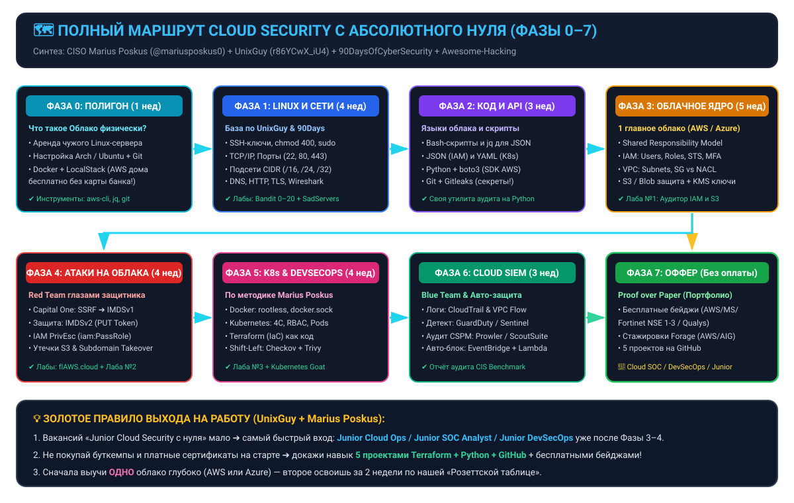

# ☁️🛡️ ПОЛНЫЙ КУРС ПО CLOUD SECURITY С АБСОЛЮТНОГО НУЛЯ (Энциклопедия v1.0)

> 🧭 **Навигатор:** [[README|Главная]] • [[Разбор-Видео-MariusPoskus-и-UnixGuy|Разбор видео & стратегия]] • [[Бесплатная-Замена-Сертификатов|Замена сертификатов ($0)]] • [[Чек-лист-Прогресса-CloudSec|Чек-лист]] • [[Окно-Быстрых-Вспоминанок|Окно Вспоминанок]] • [[Все-Проверенные-Источники-Мира|Все источники]] • [[05-Галерея-Схем-и-Путей|12 схем и путей]]

> [!IMPORTANT] **Главный принцип этого курса**
> Этот курс написан для человека, который начинает **с абсолютного нуля** в облачных технологиях. Здесь нет «воды» и заумных фраз без перевода. Каждый термин объясняется:
> 1. **Простыми словами и бытовой аналогией из реальной жизни.**
> 2. **Реальным примером взлома или настройки на практике.**
> 3. **Конкретными командами для твоего Linux (Arch / Ubuntu) и облачного CLI.**
> 4. **Визуальной схемой (у нас 12 подробных схем пути!).**

---

## 🗺️ Карта всего маршрута (Фазы 0–7)



| Фаза | Тема | Срок (при 2 ч/день) | Что ты реально умеешь в конце фазы |
| :---: | :--- | :---: | :--- |
| **0** | **Что такое Облако + Полигон без карты** | 1 неделя | Понимаешь физику облака; стоят Docker, Git, `aws-cli`, Terraform и **LocalStack** (бесплатный AWS у тебя на ПК) |
| **1** | **Linux & Сети глазами облачника** | 3–4 недели | Уверенно пользуешься SSH-ключами (`chmod 400`), понимаешь порты, подсети CIDR (`/24`, `/32`), DNS, TLS; прошёл `Bandit` и `SadServers` |
| **2** | **Python, Bash, JSON/YAML и Git** | 3 недели | Читаешь и пишешь политики в JSON/YAML, пишешь скрипты автоматизации на Python (`boto3`), ловишь утечки ключей через `Gitleaks` |
| **3** | **Фундамент Облака: IAM, VPC, S3, KMS** | 4–5 недель | Разбираешься в Shared Responsibility, проектируешь безопасную сеть VPC, пишешь строгие IAM-политики, закрываешь S3/Blob и KMS |
| **4** | **Атаки на Облака (Red Team)** | 3–4 недели | Знаешь, как взломали Capital One (`SSRF ➔ IMDSv1`), защищаешь через `IMDSv2`, находишь `IAM PrivEsc`, прошёл `flAWS.cloud` и Лабу №2 |
| **5** | **Docker, Kubernetes, Terraform & DevSecOps** | 4 недели | Защищаешь контейнеры (без root и `--privileged`), знаешь 4C в K8s, пишешь инфраструктуру в Terraform и проверяешь её через `Checkov` и `Trivy` |
| **6** | **Облачный SIEM, Логи и Авто-реакция** | 3 недели | Настраиваешь аудит (`CloudTrail` / `Activity Log`), ищешь угрозы (`GuardDuty` / `Sentinel`), запускаешь аудит `Prowler` и пишешь авто-реакцию |
| **7** | **Бесплатные бейджи, 5 проектов и Работа** | Постоянно | Имеешь 3–5 бесплатных бейджей, стажировки Forage, 5 проектов на GitHub и резюме на Junior Cloud Ops / Cloud SOC / DevSecOps |

**Честная оценка срока:** при спокойном темпе 1.5–2 часа в день путь с абсолютного нуля до уровня уверенного джуна с портфолио занимает **6–9 месяцев** (а на базовую стажировку/позицию Junior SOC или Junior Cloud Ops можно откликаться уже после Фазы 3–4!).

---

## 🧠 Как учиться, чтобы дойти до конца и не запутаться

1. **Забудь про голые сертификаты на старте:** По словам **CISO Marius Poskus** (`@mariusposkus0`), покупка 3–4 бумажек при пустом GitHub создаёт *«проблему отсутствия доказательств»*. Поэтому в этом курсе мы сначала заменяем платные сертификаты на бесплатные альтернативы ([[Бесплатная-Замена-Сертификатов]]) и делаем ставку на **практику и 5 реальных проектов**.
2. **Сначала ОДНО облако (по методу UnixGuy):** Не пытайся учить AWS, Azure и GCP одновременно. Выбери **AWS** (лидер по доле рынка и бесплатным хакерским полигонам `flAWS.cloud` / `CloudGoat` / `LocalStack`) **или Microsoft Azure** (если в твоём регионе или в банках чаще требуют `Entra ID` + `Microsoft Sentinel`). Когда поймёшь логику в одном облаке, второе освоишь за пару недель по схеме [[10_aws_vs_azure_vs_gcp_rosetta_map.svg]].
3. **Используй «Окно Маленьких Вспоминанок»:** Мозг забывает новые команды и порты через 2 дня. Каждый день перед началом урока трать **5 минут** на пролистывание карточек в [[Окно-Быстрых-Вспоминанок]] (или в плавающем окне `Alt + M` на интерактивном сайте!).
4. **Правило «1 к 3»:** 15 минут чтения или видео = 45 минут руками в терминале или в Python-лабах.
5. **⚖️ Закон и этика:** Никогда не сканируй чужие облачные бакеты, поддомены и API без письменного разрешения (Bug Bounty scope). Вся практика идёт на своём ПК (`LocalStack` + Docker), на официальных полигонах (`flAWS.cloud`, `PwnedLabs`, `OverTheWire`, `Kubernetes Goat`) или в твоём личном тестовом аккаунте с установленным лимитом биллинга **$0 / $1**.

---

## 🛠️ ФАЗА 0 — Что такое Облако на самом деле и настройка бесплатного полигона (Неделя 1)

### 🧠 Объяснение с абсолютного нуля
Многие новички думают, что «Облако» (Cloud) — это нечто эфемерное в интернете. На самом деле:
> **Облако — это просто гигантские охраняемые ангары (дата-центры) компаний Amazon, Microsoft или Google, набитые миллионами мощных компьютеров на базе Linux, которые ты арендуешь через интернет по секундам.**

**Бытовая аналогия — Электростанция vs Генератор:**
- **Обычный сервер компании (On-Premises):** ты покупаешь бензиновый генератор, ставишь его на балконе, сам заливаешь бензин, чинишь мотор и молишься, чтобы его не залило дождём. Если пришло в 10 раз больше гостей — света не хватит.
- **Облако (Cloud):** ты просто втыкаешь вилку в розетку и платишь за киловатты. Нужен 1 сервер сегодня и 100 серверов в «Чёрную пятницу» — нажимаешь кнопку (или запускаешь скрипт Terraform), и через 15 секунд у тебя 100 серверов.

### Почему 99% новичков боятся начинать и как учиться БЕЗ банковской карты?
Для регистрации в реальном AWS или Azure нужна банковская карта (даже для бесплатного Free Tier — чтобы проверить личность), а если забыть выключить мощный сервер, можно получить счёт.
**Решение в нашем курсе:** на Фазах 0–5 мы используем **LocalStack** (бесплатный официальный эмулятор AWS, который работает прямо в Docker у тебя на компьютере), **бесплатные браузерные тренажёры** (`flAWS.cloud`, `PwnedLabs`, `SadServers`, `TryHackMe`, `AWS Skill Builder`) и **локальные Python-лабы**! Никаких рисков списать деньги.

### 🛠️ Практика Фазы 0
Подробная инструкция по установке на **Arch Linux** и **Ubuntu** лежит в [[README-Labs]]. Кратко, что нужно поставить:
1. `git`, `curl`, `jq` (удобный просмотр JSON прямо в терминале), `python3`, `docker`.
2. `awscli` (официальный пульт управления AWS из терминала) и `terraform`.
3. Настройка `.gitignore` (никогда не загружать `.env`, `*.pem`, `*.tfstate` на GitHub!).

---

## 🐧 ФАЗА 1 — Linux и Сети глазами Облачного Безопасника (Недели 2–5)

> Подробный учебник этой фазы: [[01-Linux-и-Сети-для-Облаков]] и схема [[11_linux_networking_to_cloud_bridge.svg]].

### Что обязательно освоить (минимум)
1. **SSH и асимметричная криптография (Вход в облачные серверы):**
   - Почему в облаке пароль почти не используют: боты подбирают пароли за минуты. Используются два ключа: **Публичный** (висит как замок на сервере в `~/.ssh/authorized_keys`) и **Приватный** (лежит только у тебя на диске, файл `.pem` или `id_ed25519`).
   - Почему `chmod 400 my-key.pem` — обязательная команда: Linux не даст войти по ключу, если его файл могут читать другие пользователи ПК!
2. **Пользователи, права и службы:**
   - Работа под `root` vs `sudo`; права на файлы (`rwx` = `4+2+1`, почему `777` — это дыра); службы `systemd` (`systemctl status sshd`).
3. **Сети и Подсети CIDR (Без них не понять облачный VPC!):**
   - **Аналогия с домом:** IP-адрес `10.0.1.0/24` — это **подъезд №1** (последнее число от `0` до `255` — это 256 квартир). Маска `/32` (`203.0.113.5/32`) — это **одна конкретная квартира** (только твой домашний IP). Маска `0.0.0.0/0` — **ВСЕ люди на планете Земля!**
   - **Главные порты облачника:** `22` (SSH), `3389` (RDP Windows), `80` (HTTP), `443` (HTTPS), `5432` (PostgreSQL), `3306` (MySQL), `6379` (Redis — часто взламывают, если открыт!), `6443` (Kubernetes API).
   - Утилиты диагностики: `ss -tulnp` (какие двери открыты на сервере), `dig` / `nslookup` (куда ведёт домен), `curl -v` (проверка HTTP-ответа).

### 🛠️ Практика Фазы 1
- **OverTheWire Bandit** (уровни 0–20): https://overthewire.org/wargames/bandit/ — отработать терминал и SSH-ключи.
- **SadServers** (бесплатно в браузере): https://sadservers.com/ — чинить реальные «сломанные» облачные Linux-серверы (задачки *Saint John*, *Saskatoon*, *Oaxaca*).
- Записать 15+ коротких команд в своё [[Окно-Быстрых-Вспоминанок]].

---

## 🐍 ФАЗА 2 — Python, Bash, JSON/YAML и Git для автоматизации (Недели 6–9)

В облаке **всё** является текстом и API-запросами:
- **JSON** — на нём написаны все правила доступа (IAM Policies) и ответы `aws-cli`. Фильтруется в терминале за секунду через `jq`!
- **YAML** — на нём написаны конфиги Docker Compose, Kubernetes, GitHub Actions и правила SIEM. Одна лишняя пробел-табуляция ломает файл.
- **Bash** — склейка команд аудита: циклом проверить 100 бакетов или прочитать логи.
- **Python (`boto3`)** — главный язык автоматизации облачной безопасности. В Фазе 2 ты напишешь свой первый скрипт аудита, не заходя в веб-консоль!
- **Git и секреты (`Gitleaks`):** самая частая катастрофа новичков — сделать `git push` с настоящим ключом доступа `AKIA...` в публичный репозиторий. Боты сканируют GitHub и находят забытый ключ **за 10–30 секунд**, после чего запускают там криптомайнеры на тысячи долларов!

---

## ☁️ ФАЗА 3 — Фундамент Облака: Shared Responsibility, IAM, VPC, S3 и KMS (Недели 10–14)

> Подробный учебник этой фазы: [[02-AWS-и-Azure-Фундамент-и-IAM]] + схемы [[02_shared_responsibility_model.svg]], [[03_iam_architecture_and_privesc_path.svg]], [[04_cloud_network_vpc_architecture.svg]], [[06_s3_storage_misconfig_and_encryption.svg]].

Здесь закладываются **4 кита безопасности любого облака**:
1. **Модель разделения ответственности:** провайдер охраняет физический дата-центр, кабели и серверы (*Security OF the Cloud*), а ты отвечаешь за свои настройки, пароли, открытые порты, права пользователей и шифрование (*Security IN the Cloud*).
2. **IAM (Identity & Access Management):**
   - **Root-аккаунт** = владелец здания с главным мастер-ключом. Включаем аппаратный или TOTP MFA и прячем в сейф!
   - **IAM User** = постоянный сотрудник (логин/пароль или `AccessKey`).
   - **IAM Role** = временная «шляпа/бейдж», который сервер EC2 надевает сам, чтобы не хранить вечные пароли на диске!
   - **Логика оценки прав:** По умолчанию всё **Запрещено** ➔ Явный **Deny** всегда побеждает **Allow** ➔ Только явный **Allow** даёт доступ.
   - **Least Privilege (Минимальные привилегии):** давай серверу доступ ровно к 1 бакету на чтение, а не `"Action": "*", "Resource": "*"`.
3. **Облачная сеть VPC:**
   - **Public Subnet** (видна из интернета через IGW) — тут стоят только входные балансировщики (ALB) и NAT Gateway.
   - **Private Subnet** (нет публичных IP!) — здесь живут серверы приложения и микросервисы.
   - **Isolated Subnet** — здесь сидят базы данных (RDS), доступные только из Private Subnet.
   - **Security Group (Stateful)** vs **Network ACL (Stateless)** — главный вопрос на всех собеседованиях!
4. **Хранилища (S3 / Azure Blob) и шифрование (KMS):**
   - **Block Public Access** включён на уровне всего аккаунта.
   - **Envelope Encryption (Конвертное шифрование):** главный ключ в KMS никогда не покидает сейф, а для каждого файла генерируется быстрый Data Key.

### 🛠️ Практика Фазы 3
Запусти в терминале нашу первую лабораторную работу:
```bash
python3 02-Labs/lab01_s3_and_iam_auditor.py
```
Она покажет, как автоматически находить опасные `"Action": "*"` и публичные бакеты в JSON-конфигурациях!

---

## 💥 ФАЗА 4 — Атаки на Облака (Red Team) и Разбор Реальных Взломов (Недели 15–18)

> Подробный учебник: [[03-Атаки-на-Облака-и-Защита]] + схема [[05_ssrf_to_imds_attack_path.svg]].

Чтобы хорошо защищать облако, ты должен понимать, **как хакер его ломает**:
1. **Взлом Capital One (SSRF ➔ IMDS `169.254.169.254`):**
   - На каждом сервере в AWS, Azure и GCP работает специальный внутренний адрес **`169.254.169.254`** (служба метаданных). Если веб-приложение позволяет подставить этот адрес (баг SSRF), хакер забирает временные ключи IAM-роли этого сервера!
   - **Как чинят:** принудительно включают **IMDSv2** (`http_tokens = "required"`), который требует предварительного `PUT`-запроса с секретным токеном и блокирует проксированные запросы!
2. **IAM Privilege Escalation:** как через забытые права `iam:PassRole + ec2:RunInstances`, `iam:CreatePolicyVersion` или `lambda:UpdateFunctionCode` пользователь с «безобидными» правами захватывает права администратора всего облака.
3. **Утечки S3 и Subdomain Takeover:** как хакеры перебирают названия бакетов (`company-backups`, `company-dev`) и перехватывают заброшенные DNS CNAME записи на Azure/AWS/GitHub Pages.

### 🛠️ Практика Фазы 4
1. Запусти нашу вторую лабораторную работу (безопасная модель атаки Capital One + защиты IMDSv2):
   ```bash
   python3 02-Labs/lab02_ssrf_imds_simulator.py
   ```
2. Пройди **бесплатно** в браузере легендарный полигон **flAWS.cloud** (Уровни 1–6) и **flAWS2.cloud** (Attacker + Defender)! Пошаговая подсказка к каждому уровню уже разобрана в [[03-Атаки-на-Облака-и-Защита]].

---

## 🐳 ФАЗА 5 — Docker, Kubernetes, Terraform (IaC) и DevSecOps (Недели 19–22)

> Подробный учебник: [[04-Docker-Kubernetes-Terraform-DevSecOps]] + схемы [[07_containers_docker_kubernetes_security.svg]] и [[08_terraform_iac_devsecops_pipeline.svg]].

Именно этот блок **CISO Marius Poskus** называет главным отличием современного Cloud Security Engineer от «бумажного теоретика»:
1. **Безопасность Docker:** почему нельзя запускать процесс от `root` внутри контейнера (`USER 10001`), почему флаг `--privileged` и проброс `/var/run/docker.sock` равны полному захвату хоста, и как проверять образы утилитой **Trivy**.
2. **Безопасность Kubernetes (K8s):** модель **4C** (*Cloud ➔ Cluster ➔ Container ➔ Code*), устройство `Control Plane` (`kube-apiserver`, `etcd`), настройка `RBAC`, запрет анонимного `kubelet` (:10250), отключение лишних `ServiceAccount` токенов и сетевые политики `NetworkPolicy`.
3. **Terraform и Shift-Left DevSecOps:** вместо ручного кликанья в консоли, вся облачная сеть, S3 и IAM описываются кодом (`main.tf`), а до деплоя автоматически проверяются инструментами **Gitleaks** (поиск ключей) + **Checkov / tfsec** (поиск небезопасных настроек).

### 🛠️ Практика Фазы 5
Запусти нашу третью лабораторную работу — она просканирует учебный файл `sample_vulnerable_main.tf` и найдёт в нём 5 критических облачных дыр, как настоящий Checkov:
```bash
python3 02-Labs/lab03_terraform_sec_check.py
```

---

## 📡 ФАЗА 6 — Облачный SIEM, Логи и Авто-реагирование (Недели 23–25)

> Схема пути обнаружения и автоответа: [[09_cloud_siem_detection_incident_path.svg]].

1. **Камеры видеонаблюдения облака:**
   - **AWS CloudTrail** / **Azure Activity Log** — записывает каждый API-вызов (кто создал пользователя, скачал файл или отключил логи!).
   - **VPC Flow Logs** — кто, на какой порт и сколько данных передал по сети.
2. **Умные детекторы угроз и Облачный SIEM:**
   - **Amazon GuardDuty** и **Microsoft Defender for Cloud** ловят кражу ключей (`Exfiltration.OutsideAWS`), майнеров и сканирование портов.
   - **Microsoft Sentinel** / **AWS Security Hub** сводят тревоги в единый пульт SOC.
3. **Непрерывный аудит (CSPM):** утилиты **Prowler** и **ScoutSuite** за 5 минут проверяют облачный аккаунт на сотни правил стандарта **CIS Benchmark**.
4. **SOAR (Автоматический ответ):** связка `GuardDuty ➔ EventBridge ➔ Lambda` за 3 секунды без участия человека отзывает скомпрометированную сессию и переводит взломанный сервер в карантин.

---

## 🏆 ФАЗА 7 — Бесплатная замена сертификатов, 5 проектов портфолио и Выход на работу (Недели 26+)

- Чёткий план получения 3–5 бесплатных официальных бейджей и прохождения стажировок: [[Бесплатная-Замена-Сертификатов]].
- Подробные ТЗ для **5 боевых проектов на GitHub**: [[06-5-Проектов-Портфолио-и-CTF]].
- Стратегия входа на первую работу и готовый шаблон резюме: [[07-Карьера-CloudSec-GRC-и-Шаблон-Резюме]].
