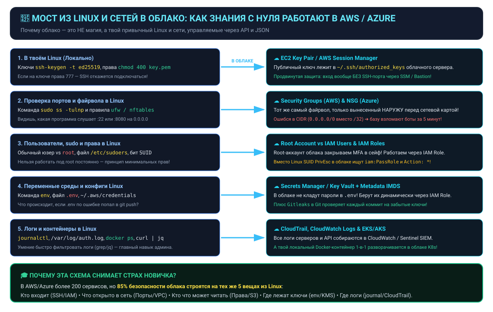

# 🐧🌐 01. Linux и Сети глазами Облачного Безопасника (С абсолютного нуля)

> 🧭 **Связанные разделы:** [[Полный-Курс-Cloud-Security-С-Нуля|Курс]] • [[11_linux_networking_to_cloud_bridge.svg|Схема: Мост в облако]] • [[Окно-Быстрых-Вспоминанок|Окно Вспоминанок]] • [[Переводчик-Облаков-AWS-Azure-GCP-Linux|Команды]]

---

## 🧠 1. Зачем облачному безопаснику знать Linux?
90% облачных серверов в мире (EC2 в AWS, виртуальные машины в Azure, ноды Kubernetes, контейнеры Docker) работают на **Linux**. Даже когда ты пользуешься «безсерверными» функциями (AWS Lambda) или облачными базами данных, внутри дата-центра Amazon/Microsoft крутится Linux-ядро!



---

## 🔑 2. Как входят на облачный сервер: SSH-ключи и `chmod 400`

**🏠 Бытовая аналогия:**
Обычный пароль — это кодовый замок, который хакер может подбирать миллионами комбинаций.
А **SSH-ключ (асимметричная пара)** — это **замок и уникальный титановый ключ**:
- **Публичный ключ (`id_ed25519.pub`)** — это **открытый замок**. Его ты кладёшь на удалённый сервер в облаке (в файл `~/.ssh/authorized_keys`). Его можно даже показать всему миру — с его помощью нельзя открыть дверь, можно только повесить замок!
- **Приватный ключ (`id_ed25519` или `cloud-key.pem`)** — это **твой личный физический ключ**, который НИКОГДА не покидает твой ноутбук.

### Как создать современный ключ и войти на сервер:
```bash
# 1. Создать современный криптостойкий ключ Ed25519 (гораздо быстрее и надёжнее старого RSA)
ssh-keygen -t ed25519 -C "core37-cloud-lab"

# 2. В облаке AWS тебе часто дают готовый файл key.pem.
# Обязательно поставь права «читать только владельцу» (иначе SSH откажется работать!):
chmod 400 ~/Downloads/my-cloud-key.pem

# 3. Подключиться к облачному серверу Ubuntu/Amazon Linux:
ssh -i ~/Downloads/my-cloud-key.pem ubuntu@203.0.113.10
```

### 🔥 Главные дыры SSH в облаке (Что проверяет аудитор):
1. `PasswordAuthentication yes` в файле `/etc/ssh/sshd_config` — разрешён вход по паролю ➔ боты за пару часов переберут пароль. В облаке ставим `no`!
2. `PermitRootLogin yes` — разрешён прямой вход под суперпользователем `root`. Нужно `no`.
3. На Security Group порт `22` открыт для всего интернета (`0.0.0.0/0`). **Идеал в современном облаке:** вообще не открывать порт 22 в интернет, а входить через **AWS Systems Manager (SSM) Session Manager** или **Azure Bastion** через зашифрованный канал самого облака!

---

## 🛡️ 3. Права на файлы, пользователи и логи в Linux (Как на облачном сервере)

**🏠 Аналогия прав (`rwx`):**
В Linux у каждого файла есть владелец, группа и остальные люди. Права записываются цифрами (`r=4`, `w=2`, `x=1`):
- `400` (`-r--------`) = **Секретный дневник:** читать могу ТОЛЬКО я, даже удалять/править случайно нельзя. (Идеально для `.pem` ключей!).
- `644` (`-rw-r--r--`) = **Доска объявлений:** я пишу, остальные только читают.
- `755` (`-rwxr-xr-x`) = **Программа/скрипт:** я меняю и запускаю, остальные могут запускать, но не менять.
- `777` (`-rwxrwxrwx`) = **Критическая дыра безопасности!** Любой взломанный веб-скрипт может переписать чужой файл или подменить программу!

### 6 команд Linux, без которых не прожить в облаке:
```bash
# 1. Посмотреть какие порты и программы сейчас «слушают» сеть на сервере:
sudo ss -tulnp

# 2. Посмотреть процессы и от какого пользователя запущен сервер (НЕ от root ли?):
ps aux | grep -E "nginx|python|docker|kubelet"

# 3. Проверить статус службы и перезапустить её после изменения конфига:
sudo systemctl status sshd

# 4. Посмотреть логи атак и неудачных входов в Arch Linux vs Ubuntu:
# Arch Linux:
journalctl -u sshd | grep -i "Failed password"
# Ubuntu / Debian:
sudo grep -i "Failed password" /var/log/auth.log

# 5. Найти опасные файлы с битом SUID (способ повышения прав с обычного юзера до root):
find / -perm -4000 -type f 2>/dev/null

# 6. Проверить переменные окружения (часто там забывают пароли и токены API!):
env | grep -iE "AWS|AZURE|TOKEN|SECRET|PASS"
```

---

## 🌐 4. Сети и Подсети CIDR (Объяснение, после которого ты поймёшь любой облачный VPC)

### Что такое IP-адрес и Порт?
- **IP-адрес (`10.0.1.25`)** — это **почтовый адрес дома** (улица + номер здания).
- **Порт (`0`–`65535`)** — это **номер конкретного кабинета** внутри этого дома.

### Таблица главных портов, которые нужно знать наизусть:
| Порт | Протокол / Сервис | Зачем нужен | Опасно ли открывать миру (`0.0.0.0/0`)? |
| :---: | :--- | :--- | :--- |
| **22** | SSH | Удалённая консоль Linux | ❌ **ДА!** Только свой IP `/32` или Bastion/SSM |
| **80** | HTTP | Обычный незашифрованный сайт | ⚠️ Делать авто-редирект на 443 (HTTPS) |
| **443** | HTTPS (TLS) | Зашифрованный сайт и облачное API | ✅ Да, если это публичный сайт или Load Balancer |
| **3306** | MySQL / MariaDB | База данных | 🔥 **КАТАСТРОФА!** База должна быть только в Private Subnet |
| **3389** | RDP | Удалённый рабочий стол Windows | 🔥 **КАТАСТРОФА!** №1 вектор атак шифровальщиков (Ransomware) |
| **5432** | PostgreSQL | База данных | 🔥 **КАТАСТРОФА!** Закрывать от интернета |
| **6379** | Redis | Быстрый кэш в памяти (часто без пароля!) | 🔥 **КАТАСТРОФА!** Взламывают за минуты и ставят майнеры |
| **6443** | Kubernetes API | Пульт управления всем кластером K8s | ❌ **ДА!** Ограничивать по IP/VPN |
| **10250** | Kubelet API | Агент на рабочем сервере K8s | 🔥 **КАТАСТРОФА!** Анонимный доступ = RCE внутри всех подов! |

---

### 🏢 Как навсегда понять маску подсети (CIDR: `/16`, `/24`, `/32`, `0.0.0.0/0`)

IPv4-адрес состоит из 4 чисел, каждое — это 8 бит (всего **32 бита**).
**Маска `/N`** просто говорит: *«Первые `N` бит заморожены (это название улицы/квартала), а остальные `32 - N` бит можно менять (это номера квартир)!»*

**🏠 Бытовая аналогия с многоквартирным домом:**
1. **`10.0.0.0/16` — Весь жилой комплекс (VPC):**
   - Заморожены первые 2 числа (`10.0.X.Y`).
   - Внутри: **65,536 адресов**. Так обычно размечают целый **VPC** компании в AWS/Azure.
2. **`10.0.1.0/24` — Один конкретный подъезд (Subnet):**
   - Заморожены первые 3 числа (`10.0.1.X`).
   - Внутри: **256 адресов** (от `.0` до `.255`; в AWS 5 адресов зарезервированы системой, остаётся 251). Так размечают одну подсеть (например, `Public Subnet`).
3. **`203.0.113.5/32` — Одна конкретная квартира (1 человек):**
   - Заморожены все 32 бита! Всего **1 адрес**.
   - Именно с `/32` нужно указывать свой домашний или офисный IP в правилах файрвола!
4. **`0.0.0.0/0` — ВСЯ ПЛАНЕТА ЗЕМЛЯ:**
   - Не заморожен НИ ОДИН бит! Это значит: *«Впустить кого угодно с любого IP в мире»*.

### Приватные vs Публичные IP-адреса (RFC 1918)
Внутри твоей квартиры (роутер) и внутри облачного VPC адреса выдаются из **приватных диапазонов** (они не маршрутизируются в публичном интернете):
- `10.0.0.0/8` (`10.x.x.x`) — стандарт для облаков (AWS VPC, Kubernetes).
- `172.16.0.0/12` (`172.16.x.x` – `172.31.x.x`) — дефолтный VPC в AWS (`172.31.0.0/16`) и сети Docker (`172.17.0.0/16`).
- `192.168.0.0/16` (`192.168.x.x`) — твой домашний Wi-Fi роутер.

> **Важный адрес-ловушка облака:** **`169.254.169.254/32`** (Link-Local). Это не интернет и не соседний сервер — это **внутренний номер службы метаданных самого облачного сервера (IMDS)**! Его мы подробно разберём в главе об атаке на Capital One.

---

## 🔍 5. DNS и TLS (Как мы проверяем домены и сертификаты в терминале)

1. **DNS (Телефонная книга интернета):** переводит имя `api.bank.com` в IP `52.14.88.10`.
   - Запись `A` ➔ указывает на IPv4 адрес.
   - Запись `CNAME` ➔ указывает на другое имя (например, `shop.company.com ➔ shop.s3.amazonaws.com`). Именно заброшенные `CNAME` приводят к атаке **Subdomain Takeover**!
2. **TLS (HTTPS):** шифрует трафик от твоего браузера до облачного балансировщика (ALB/CloudFront), чтобы провайдер Wi-Fi в кафе не увидел твой пароль и куки.

```bash
# Посмотреть куда ведёт домен (A и CNAME записи):
dig +short app.example.com
dig CNAME dev.example.com

# Проверить заголовки и TLS-сертификат облачного сайта:
curl -I https://example.com
```

---

## 🧪 Практика к этой главе
1. Открой **[[Окно-Быстрых-Вспоминанок]]** и проверь себя по карточкам раздела **«Linux & Сети»**.
2. Зарегистрируйся бесплатно на https://sadservers.com/ и реши первую задачу (*Saint John* — найти и починить сервис на Linux-сервере).
3. Пройди уровни 0–15 на https://overthewire.org/wargames/bandit/.
