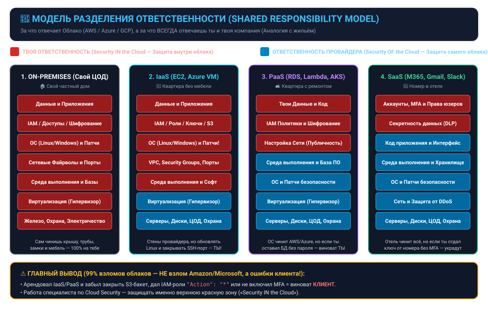
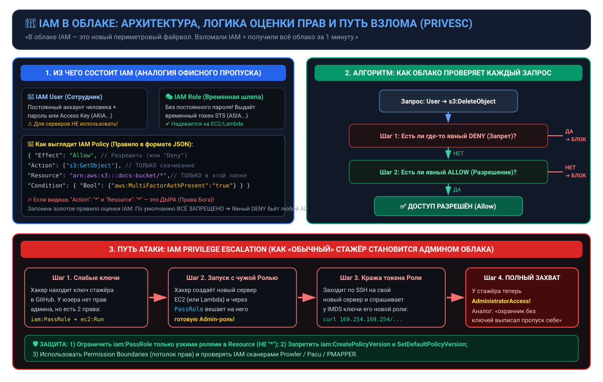
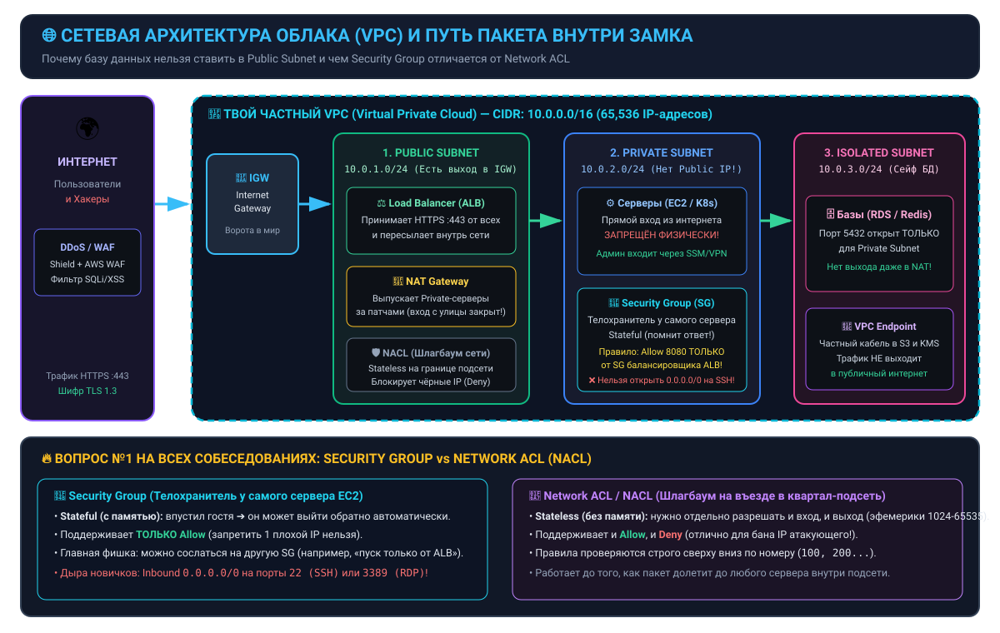
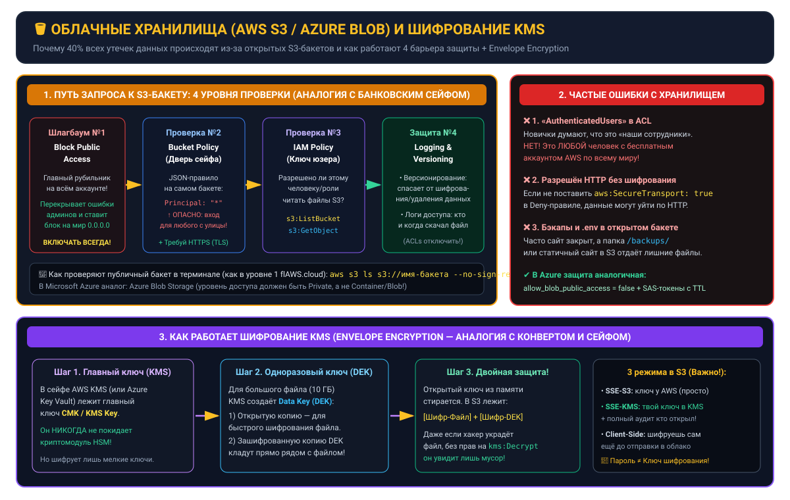

# ☁️🔑 02. Фундамент Облака (AWS & Azure): Shared Responsibility, IAM, VPC, S3 и KMS

> 🧭 **Связанные разделы:** [[Полный-Курс-Cloud-Security-С-Нуля|Курс]] • [[02_shared_responsibility_model.svg|Схема: Shared Responsibility]] • [[03_iam_architecture_and_privesc_path.svg|Схема: IAM]] • [[04_cloud_network_vpc_architecture.svg|Схема: VPC]] • [[06_s3_storage_misconfig_and_encryption.svg|Схема: S3 & KMS]]

---

## 🤝 1. Модель разделения ответственности (Shared Responsibility Model)



Главное заблуждение новичков: *«Мы переехали в Amazon/Microsoft — теперь за безопасность отвечают они!»*
На самом деле безопасность делится на две половины:
- **Security OF the Cloud (Защита САМОГО облака — Провайдер):** охрана с автоматами у ворот дата-центра, питание, кондиционеры, замена сгоревших жёстких дисков, патчи гипервизора виртуализации.
- **Security IN the Cloud (Защита ВНУТРИ облака — ТЫ / Клиент):**
  - В **IaaS** (`EC2` / `Azure VM`): ты сам обязан обновлять Linux, закрывать порт 22, настраивать шифрование дисков, правила файрвола (Security Groups) и права IAM.
  - В **PaaS** (`AWS RDS` / `Azure SQL` / `Lambda`): провайдер обновляет ОС за тебя, но если ты выдал базе публичный IP или слабый пароль — взлом на твоей совести.
  - В **SaaS** (`Microsoft 365` / `Gmail`): провайдер отвечает почти за всё, кроме самого главного — **кто имеет доступ (MFA, пароли, права сотрудников и утечки файлов)**.

---

## 🔑 2. IAM (Identity and Access Management) — «Новый периметровый файрвол»

Раньше безопасность строилась как замок со стеной: кто внутри офисной сети — тому доверяем. В облаке сервера общаются через API по интернету, поэтому **главной границей стала Идентификация (Identity / IAM)**.



### 5 главных понятий IAM на аналогии с банком:
1. **Root Account (Учредитель банка):** Главный логин, на который регистрировался аккаунт. Имеет абсолютные права (даже удалить весь аккаунт!).
   - **Золотое правило:** Сразу включить аппаратный или TOTP **MFA**, не создавать для него Access Key и **убрать в сейф**. Для повседневной работы не использовать никогда!
2. **IAM User (Постоянный сотрудник):** Имеет имя, пароль (для входа в веб-консоль) и/или постоянную пару ключей (`AccessKeyId`, начинающийся с `AKIA...` + `SecretAccessKey`, для терминала CLI).
   - **Современный стандарт:** в продакшене от постоянных `IAM Users` отказываются в пользу **IAM Identity Center (SSO)** и временных ролей!
3. **IAM Group (Отдел):** Например, группа `Developers` или `Security-Auditors`. Удобнее давать права группе, чем 50 людям по отдельности.
4. **IAM Role (Временный бейдж / Шляпа):** **Самая важная концепция в облаке!** У роли НЕТ постоянного пароля. Она выдаёт **временный пропуск через службу STS** (ключ начинается с **`ASIA...`** + есть `SessionToken` + таймер жизни, например, 1 час!).
   - **Зачем нужна:** Когда твой сервер `EC2` хочет положить фото в `S3`, ты **НЕ кладёшь** вечный пароль в код на сервере! Ты просто «надеваешь» на сервер **IAM Role** — и сервер сам берёт временный токен.
5. **IAM Policy (Должностная инструкция в JSON):** Документ из 4 полей:
   - `Effect`: `"Allow"` или `"Deny"`.
   - `Action`: какие команды разрешены (напр. `"s3:GetObject"`, `"ec2:DescribeInstances"`).
   - `Resource`: к какому именно объекту (`"arn:aws:s3:::public-images/*"`).
   - `Condition` (необязательно, но очень сильно!): дополнительные условия — например, «разрешено ТОЛЬКО если пользователь вошёл с MFA или с корпоративного IP».

### Как облако принимает решение «Пустить или Запретить?»
Запомни раз и навсегда алгоритм оценки (3 шага):
1. **По умолчанию (Implicit Deny):** Всё запрещено всем.
2. **Поиск явного запрета (Explicit Deny):** Если ХОТЯ БЫ В ОДНОЙ из 10 привязанных политик написано `"Effect": "Deny"` на это действие ➔ **ДОСТУП ЗАКРЫТ БЕЗ ПРАВА ОБЖАЛОВАНИЯ!** (`Deny` всегда бьёт `Allow`).
3. **Поиск разрешения (Explicit Allow):** Если явного запрета нет, но хотя бы в одной политике есть `"Effect": "Allow"` ➔ **Доступ разрешён**.

---

## 🌐 3. Облачная сеть VPC (Virtual Private Cloud)

**VPC** — это твой собственный изолированный виртуальный дата-центр внутри облака (как выделенный квартал со своим забором).



### Как правильно разложить серверы по 3 подсетям:
1. **Public Subnet (Публичная — Витрина):** Имеет маршрут в **Internet Gateway (IGW)**. Сюда ставят **только** балансировщик нагрузки (ALB) и **NAT Gateway**.
2. **Private Subnet (Приватная — Офис и цех):** Не имеет публичных IP и маршрута в IGW! Сюда ставят сами серверы приложений и контейнеры. Чтобы они могли скачать обновления пакетов с интернета, их исходящий трафик идёт в одну сторону через **NAT Gateway** (снаружи к ним не постучаться!).
3. **Isolated Subnet (Изолированная — Подземный сейф):** Сюда ставят базы данных (RDS, PostgreSQL, Redis). Входящий трафик разрешён **только** от серверов в Private Subnet на порт БД (напр. `5432`).
   - А чтобы серверы общались с S3 или KMS без выхода в открытый интернет, ставят **VPC Endpoint** (частный подземный кабель внутри дата-центра).

### Security Group (SG) vs Network ACL (NACL)
- **Security Group** — **телохранитель прямо на входе в конкретный сервер**. Он *Stateful* (с памятью): если впустил клиента на `:443`, автоматически выпустит ответ. В SG можно писать только правила `Allow` (всё остальное запрещено само).
- **NACL** — **шлагбаум на въезде в целый квартал (подсеть)**. Он *Stateless* (без памяти): проверяет и вход, и выход отдельно. Зато в NACL можно явно написать `DENY` для конкретного IP-адреса атакующего!

---

## 🪣 4. Хранилища S3 / Azure Blob и Криптография KMS



### Почему S3-бакеты — источник №1 громких утечек?
Бакеты S3 часто создают для хранения картинок сайта, а потом разработчики туда же складывают `db_backup.sql`, сканы паспортов клиентов или файлы конфигурации — и забывают закрыть доступ!

**Чек-лист идеальной защиты S3 (и Azure Blob):**
1. **Block Public Access** включён на **уровне всего аккаунта** (4 галочки). Тогда даже опечатка разработчика не откроет бакет в мир.
2. **Bucket Policy с требованием HTTPS:** явный `Deny` всем запросам, у которых `"aws:SecureTransport": "false"` (запрет нешифрованного HTTP).
3. **Versioning (Версионирование) + Object Lock:** если шифровальщик или хакер перезапишет/удалит файлы в бакете, старые версии останутся в сохранности!
4. **Отключение старых ACL (`BucketOwnerEnforced`)**: управлять правами только через понятные JSON-политики.

### Шифрование и KMS (Key Management Service)
В облаке используют **Envelope Encryption (Конвертное шифрование)**, потому что одним главным ключом нельзя быстро шифровать гигабайтные файлы:
1. Главный ключ (**KMS Key / CMK**) навсегда живёт внутри защищённого аппаратного модуля (**HSM**) облака.
2. Для шифрования файла сервис берёт у KMS временный быстрый **Data Key (DEK)**, шифрует им сам файл, а затем шифрует сам `DEK` главным ключом и кладёт зашифрованный `DEK` рядом с файлом.
3. Чтобы прочитать файл, сервер отправляет маленький зашифрованный `DEK` в KMS ➔ KMS проверяет в **IAM**, есть ли у сервера право **`kms:Decrypt`**, и записывает факт обращения в **CloudTrail**!

---

## 🧪 Практика к этой главе
Запусти в терминале **Лабу №1** — она проанализирует реальные примеры IAM-политик и S3-конфигов, укажет на ошибки и покажет безопасные исправления:
```bash
python3 02-Labs/lab01_s3_and_iam_auditor.py
```
