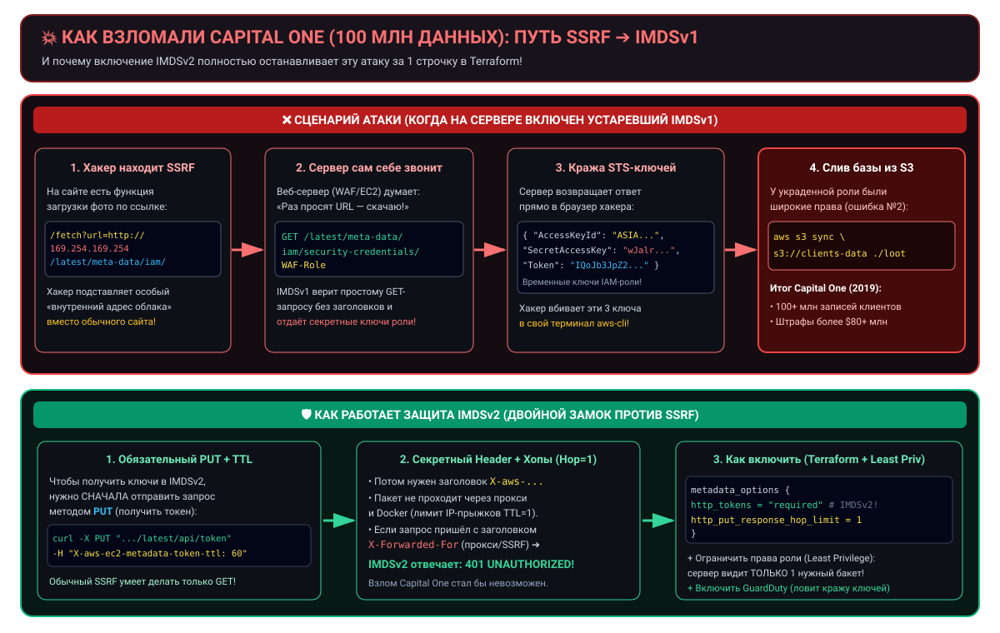

# 💥🛡️ 03. Атаки на Облака, Реальные Взломы и Разбор `flAWS.cloud`

> 🧭 **Связанные разделы:** [[Полный-Курс-Cloud-Security-С-Нуля|Курс]] • [[05_ssrf_to_imds_attack_path.svg|Схема: SSRF ➔ IMDS]] • [[03_iam_architecture_and_privesc_path.svg|Схема: IAM PrivEsc]] • [[README-Labs|Полигоны]]

---

## 1. Разбор реального взлома Capital One (SSRF ➔ IMDSv1 `169.254.169.254`)

Это **самая известная облачная атака в истории**, которую спрашивают на 9 из 10 собеседований по Cloud Security. Понимание этой цепочки сразу переводит тебя из новичка в понимающего инженера.



### Как это устроено «на пальцах»
1. На каждом сервере в AWS (EC2), Azure (VM) и GCP работает секретный внутренний справочный сервис **IMDS (Instance Metadata Service)** на специальном IP-адресе **`169.254.169.254`**.
2. Адрес доступен **только с самого сервера** — из интернета к нему не достучаться. Внутри него хранится имя компьютера, IP-адреса и... **временные секретные ключи IAM-роли, надетой на этот сервер**!
3. На веб-сервере (в данном случае неправильно настроенный WAF-прокси) оказалась веб-уязвимость **SSRF (Server-Side Request Forgery — Подделка запроса со стороны сервера)**: сайт позволял передать произвольный URL (например, в заголовке `Host` или параметре `?url=...`), и сервер послушно скачивал его сам.

### Пошаговая цепь взлома:
1. Злоумышленник передал веб-серверу адрес:
   ```text
   http://169.254.169.254/latest/meta-data/iam/security-credentials/
   ```
   Сервер обратился «сам к себе» и выдал имя роли (например, `WAF-Role`).
2. Следующим запросом злоумышленник запросил ключи этой роли:
   ```text
   http://169.254.169.254/latest/meta-data/iam/security-credentials/WAF-Role
   ```
   Поскольку на сервере работал старый **IMDSv1**, он верил любому простому `GET`-запросу и вернул в ответе JSON с `AccessKeyId`, `SecretAccessKey` и `Token`!
3. Злоумышленник вставил эти ключи в свой локальный `aws-cli`. У роли WAF оказались **избыточные права (`s3:*`)** — и с домашнего ноутбука за несколько часов были выкачаны данные 100+ миллионов заявок на кредитные карты из S3-бакетов!

*(Примечание для Azure и GCP: в **Azure** аналогичный адрес `169.254.169.254` требует заголовок `Metadata: true`, в **GCP** — заголовок `Metadata-Flavor: Google`, что уже защищает от простого SSRF без возможности подставлять заголовки!)*

### 🛡️ Как защититься (Эшелонированная оборона — 4 барьера):
1. **Включить IMDSv2 и отключить IMDSv1 (`http_tokens = "required"`):**
   - В IMDSv2 нельзя просто сделать `GET`. Сначала нужно сделать запрос методом **`PUT`** с заголовком `X-aws-ec2-metadata-token-ttl-seconds: 60`, получить одноразовый токен и передать его в `GET`-запросе. Плюс IMDSv2 блокирует пакеты, пришедшие через прокси (`X-Forwarded-For`), и ограничивает число сетевых прыжков (`Hop Limit = 1`, чтобы даже Docker-контейнер на том же сервере не смог украсть ключи хоста!).
2. **Принцип минимальных прав (Least Privilege):** у веб-сервера/WAF вообще не должно быть прав на чтение бакетов с персональными данными клиентов!
3. **Устранить сам SSRF в коде:** белый список разрешённых доменов + блокировка диапазонов `169.254.0.0/16`, `127.0.0.0/8`, `10.0.0.0/8`.
4. **Мониторинг GuardDuty:** тревога `UnauthorizedAccess:IAMUser/InstanceCredentialExfiltration.OutsideAWS` мгновенно сработает, как только ключи EC2-роли начнут вызывать за пределами AWS!

---

## 2. IAM Privilege Escalation (Повышение привилегий в облаке)

Даже если у взломанного аккаунта разработчика или стажёра нет прав администратора (`AdministratorAccess`), хакер ищет **опасные комбинации разрешений** (их описали исследователи Rhino Security Labs, создатели полигона **CloudGoat**):

| Опасные права в политике IAM | Как хакер захватывает весь аккаунт | Как исправить (Remediation) |
| :--- | :--- | :--- |
| `iam:PassRole` + `ec2:RunInstances` (или `lambda:CreateFunction`) | Создаёт новый сервер/функцию, вешает на неё готовую `AdminRole` через `PassRole`, заходит на сервер и забирает ключи из IMDS! | Запретить `"Resource": "*"` в `iam:PassRole` — разрешать передачу только конкретных узких ролей! |
| `iam:CreatePolicyVersion` | Создаёт новую версию своей же политики, вписывает туда `"Action": "*", "Resource": "*"` и делает её активной по умолчанию (`SetAsDefault`). | Запретить разработчикам редактировать свои же IAM-политики (`iam:CreatePolicyVersion`, `iam:SetDefaultPolicyVersion`). |
| `iam:AttachUserPolicy` / `iam:PutUserPolicy` | Просто прикрепляет к себе готовую политику `AdministratorAccess` одной командой `aws iam attach-user-policy`. | Разделять обязанности (Separation of Duties) и ставить **Permission Boundaries**. |
| `iam:CreateAccessKey` на `*` | Выпускает себе второй рабочий ключ доступа для чужого админского аккаунта (особенно опасно, если у админа нет API-блокировки по MFA!). | Ограничивать `Resource` значением `"arn:aws:iam::*:user/${aws:username}"` (только себе, но не коллегам!). |
| `lambda:UpdateFunctionCode` | Если на существующей Lambda-функции уже висит жирная роль, меняет её Python-код на скрипт, который шлёт переменные среды `os.environ` себе! | Запретить обновление продакшн-функций вручную (деплой только через защищённый CI/CD). |

---

## 3. Утечки S3, Заброшенные Снапшоты и Subdomain Takeover

1. **Утечки через открытые EBS-снапшоты и RDS-снимки:** Компания сделала резервную копию диска сервера («снимок») для переноса и по ошибке поставила флаг `Public`. Хакер мониторит новые публичные снапшоты, подключает копию диска к своему серверу в AWS и читает всю базу и `.env` файлы!
   - *Защита:* автоматическое шифрование всех EBS-дисков по умолчанию + запрет публичных снапшотов (`aws ec2 enable-snapshot-block-public-access`).
2. **Subdomain Takeover (Захват поддомена):**
   - **Аналогия:** Компания закрыла магазин в торговом центре, а вывеску-указатель на главной площади забыла снять. Мошенник арендовал тот же пустой павильон и принимает клиентов от лица компании.
   - **В облаке:** У компании осталась DNS-запись `promo.company.com ➔ CNAME promo-company.s3-website.amazonaws.com` (или `.azurewebsites.net`). Бакет удалили, а DNS-запись осталась! Хакер просто создаёт бакет с именем `promo-company` в своём AWS-аккаунте и вешает туда фишинговую страницу на официальном домене компании!
   - *Защита:* при удалении облачного ресурса **всегда** сначала удалять его DNS-запись (`Route53` / `Cloudflare`).

---

## 4. Пошаговая карта прохождения легендарного полигона `flAWS.cloud` (Бесплатно)

> Сайт полигона: **http://flaws.cloud/** (создан Скоттом Пайпером, всё безопасно и легально!). Вот чему учит каждый из 6 уровней:

- **Level 1 (Открытый S3-бакет):** Разведка DNS показывает, что сайт размещён на S3. Команда `aws s3 ls s3://flaws.cloud/ --no-sign-request` без пароля выводит скрытый файл `secret-*.html`! *Урок: даже если сайт выглядит как обычная HTML-страница, не держи `s3:ListBucket` открытым миру.*
- **Level 2 (Ошибка «AuthenticatedUsers»):** Бакет закрыт от анонимов, но открыт для «любого авторизованного аккаунта AWS» (Authenticated Users — это любой человек на Земле со своим бесплатным аккаунтом AWS!). *Урок: никогда не путай «сотрудников компании» с группой `AllUsers` / `AuthenticatedUsers`.*
- **Level 3 (Забытая папка `.git` в S3):** Внутри бакета найдена выложенная скрытая папка `.git/`. В истории коммитов лежит удалённый ключ доступа `AKIA...`! *Урок: удаление файла в новом коммите НЕ удаляет его из истории Git!*
- **Level 4 (Публичный EBS-снимок):** Найденные ключи позволяют просмотреть снимки дисков (`describe-snapshots`), среди которых есть публичный снимок, внутри которого лежит пароль от админки сайта. *Урок: всегда шифруй диски и запрещай публичные снапшоты.*
- **Level 5 (Атака SSRF ➔ IMDSv1):** На сайте есть прокси `?url=`. Запрос к `169.254.169.254` отдаёт ключи EC2-роли сервера! *Урок: именно так взломали Capital One; спасение — IMDSv2.*
- **Level 6 (Аудит прав Read-Only & API Gateway):** С минимальными правами чтения ищем развёрнутые Lambda-функции и скрытый URL API Gateway.

---

## 🧪 Практика к этой главе
Запусти в терминале **Лабу №2** — она в реальном времени смоделирует атаку Capital One на уязвимый локальный сервер и покажет разницу между провалом `IMDSv1` и блокировкой в `IMDSv2`:
```bash
python3 02-Labs/lab02_ssrf_imds_simulator.py
```
