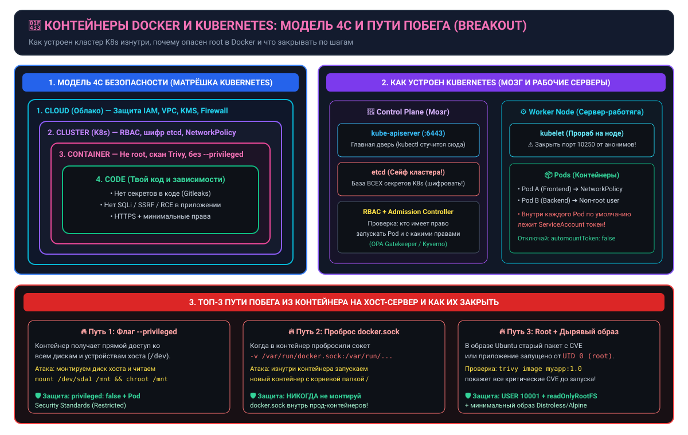
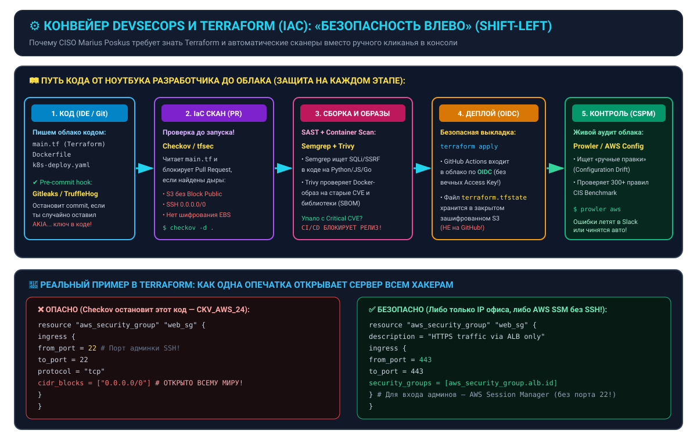
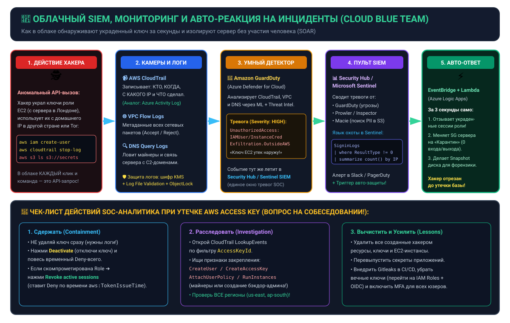

# 🐳⚙️📡 04. Docker, Kubernetes, Terraform (DevSecOps) и Облачный SIEM

> 🧭 **Связанные разделы:** [[Полный-Курс-Cloud-Security-С-Нуля|Курс]] • [[07_containers_docker_kubernetes_security.svg|Схема: Docker & K8s]] • [[08_terraform_iac_devsecops_pipeline.svg|Схема: Terraform DevSecOps]] • [[09_cloud_siem_detection_incident_path.svg|Схема: Cloud SIEM]]

---

## 🐳 1. Безопасность Docker-контейнеров с нуля

**🏠 Бытовая аналогия (VM vs Docker):**
- **Виртуальная машина (EC2/VM)** — это **отдельный частный дом** со своим фундаментом, крышей и отдельным ядром Linux.
- **Docker-контейнер** — это **изолированная квартира-капсула внутри одного общего многоквартирного дома**. Все контейнеры на сервере делят **одно общее ядро Linux**!



### Топ-4 ошибки Docker, которые приводят к полному захвату сервера (Container Breakout):
1. **Запуск процесса внутри контейнера от `root` (`UID 0`):** Если в приложении найдут баг RCE и контейнер вырвется наружу (через уязвимость ядра или проброшенную папку), атакующий уже имеет права `root`!
   - *Исправление в `Dockerfile`:* всегда создавать обычного пользователя `USER 10001:10001`.
2. **Флаг `--privileged`:** Это отключение почти всех стен между квартирой и домом. Из привилегированного контейнера можно примонтировать жёсткий диск всего сервера (`mount /dev/sda1 /mnt`) и стать `root` на хосте за 2 команды!
3. **Монтирование сокета Docker внутрь контейнера (`-v /var/run/docker.sock:/var/run/docker.sock`):** Любой скрипт внутри такого контейнера может приказать демону Docker на хосте: *«Запусти новый контейнер с диском `/` хоста!»* — мгновенный побег!
4. **Старые базовые образы (`FROM ubuntu:latest` с 200 уязвимостями CVE):**
   - *Исправление:* использовать лёгкие образы (`alpine` или `distroless`) и проверять образ перед запуском сканером **Trivy**:
     ```bash
     trivy image --severity HIGH,CRITICAL nginx:latest
     ```

---

## ☸️ 2. Безопасность Kubernetes (K8s) простыми словами

**Kubernetes (K8s)** — это «дирижёр/диспетчер», который автоматически управляет сотнями Docker-контейнеров на десятках серверов в облаке (сервисы **EKS** в AWS, **AKS** в Azure, **GKE** в Google Cloud).

### Из чего состоит K8s (и что там ломают):
- **Control Plane («Мозговой центр»):**
  - `kube-apiserver` (порт `6443`) — главная дверь управления кластером (сюда стучится утилита `kubectl`). **Опасно:** оставлять порт `6443` открытым всему интернету!
  - `etcd` — главная база данных, где лежат **все секреты и пароли кластера** (по умолчанию в старых кластерах без шифрования в base64!).
- **Worker Nodes («Рабочие серверы»):**
  - `kubelet` (порт `10250`) — прораб на каждом сервере. Если порт `10250` открыт с анонимной аутентификацией (`--anonymous-auth=true`), любой может выполнять команды во всех подах!
  - **Pods («Контейнерные капсулы»):** в каждый под по умолчанию монтируется токен `/var/run/secrets/kubernetes.io/serviceaccount/token`. Если взломают сайт в поде, токен покажет, какие права в K8s есть у этого пода (`automountServiceAccountToken: false` спасает!).
- **Защита (Модель 4C):**
  1. **Cloud:** закрытый VPC, IAM/IRSA вместо статических ключей.
  2. **Cluster:** жёсткий **RBAC** (кто какие команды может делать), **NetworkPolicy** (под фронтенда не должен иметь доступ к порту БД напрямую!), шифрование `etcd`.
  3. **Container:** Pod Security Standards (`Restricted`: запрет `root`, запрет `privileged`, `readOnlyRootFilesystem: true`).
  4. **Code:** скан образов в `Trivy` + проверка манифестов в `Kubescape` / `Checkov`.

---

## ⚙️ 3. Terraform (IaC) и Shift-Left DevSecOps (Главный навык по Marius Poskus!)

**Почему компании перешли на Terraform (Infrastructure as Code)?**
Если админ создаёт 50 серверов и 20 бакетов мышкой в веб-консоли — он обязательно забудет поставить галочку шифрования или закроет не тот порт.
**Terraform** позволяет описать всю инфраструктуру в текстовых файлах `.tf` в Git:
- Можно проверить безопасность **ДО ТОГО, КАК РЕСУРС ПОЯВИТСЯ В ОБЛАКЕ** (это и есть принцип **Shift-Left** — сдвиг безопасности влево, на этап написания кода!).



### 5 инструментов Open-Source, которые работают на каждом этапе DevSecOps:
1. **`Gitleaks` / `TruffleHog`** — проверяет Git-репозиторий и каждый коммит, чтобы никто не запушил пароль, ключ AWS `AKIA...` или приватный `.pem`.
2. **`Checkov` / `tfsec`** — статический анализ файлов Terraform (`.tf`), Dockerfile и YAML K8s до деплоя:
   ```bash
   checkov -d ./terraform-folder/
   ```
   Если в коде открыт порт `22` на `0.0.0.0/0` или не включён `IMDSv2` — сборка падает с красной ошибкой!
3. **`Semgrep`** — находит уязвимости (SQLi, SSRF, XSS) в исходном коде приложения.
4. **`Trivy`** — сканирует Docker-образы и зависимости на известные CVE + уязвимые настройки.
5. **`Prowler` / `ScoutSuite`** — уже после запуска проверяет **живой** облачный аккаунт AWS/Azure/GCP по сотням правил **CIS Benchmarks**.

> ⚠️ **Критическая опасность Terraform (`terraform.tfstate`):** Когда Terraform создаёт облако, он записывает всю карту ресурсов (включая IP, ключи и иногда пароли от баз данных!) в файл `terraform.tfstate`. **НИКОГДА не коммить `*.tfstate` на публичный GitHub!** Его хранят в приватном зашифрованном S3-бакете (Remote State).

---

## 📡 4. Облачный SIEM, Логи и Авто-реагирование (Blue Team в облаке)



Даже если хакер прорвался внутрь, защитник выигрывает за счёт **скорости обнаружения (MTTD)** и **автоматического ответа (MTTR)**:

1. **AWS CloudTrail / Azure Activity Log:** записывает **каждый API-вызов** в облаке (кто, когда, с какого IP вызвал `CreateUser`, `GetObject` или пытался отключить логи `StopLogging`).
2. **Amazon GuardDuty / Microsoft Defender for Cloud:** умный детектор угроз. Например, он мгновенно поднимет тревогу `UnauthorizedAccess:IAMUser/InstanceCredentialExfiltration.OutsideAWS`, если временный ключ EC2-сервера вдруг использовали из другой страны!
3. **Cloud SIEM (`Microsoft Sentinel` / `AWS Security Hub`):** единый пульт дежурного аналитика SOC. В Microsoft Sentinel для расследований используется язык **KQL (Kusto Query Language)** — похожий на SQL, только для огромных массивов логов.
4. **Автоматический ответ (SOAR):** через `Amazon EventBridge + AWS Lambda` (или `Azure Logic Apps`) можно за **3 секунды** автоматически переключить Security Group заражённого сервера в режим «Изоляция (0 правил входа/выхода)» и отозвать скомпрометированный токен!

---

## 🧪 Практика к этой главе
Запусти в терминале **Лабу №3** — она просканирует учебный файл `sample_vulnerable_main.tf` и наглядно покажет 5 критических уязвимостей Terraform (как Checkov/tfsec) с готовым безопасным кодом для исправления:
```bash
python3 02-Labs/lab03_terraform_sec_check.py
```
