# 🖼️🗺️ Галерея Визуальных Схем, Архитектур и Путей Атаки / Защиты

> Нажми на любую схему в Obsidian или открой вкладку **«🖼️ Галерея Схем и Путей»** на интерактивном сайте [`08-Cloud-Academy-Site/index.html`](../08-Cloud-Academy-Site/index.html), чтобы увеличить картинку на весь экран!

---

## 📋 Список всех 12 визуальных схем курса

| № | Файл схемы | Что на ней показано (Путь и Логика) |
| :---: | :--- | :--- |
| **01** | [`01_cloud_security_roadmap_zero_to_hero.svg`](01_cloud_security_roadmap_zero_to_hero.svg) | **Полный маршрут с нуля (Фазы 0–7):** синтез Marius Poskus, UnixGuy и `90DaysOfCyberSecurity` + точка раннего выхода на работу |
| **02** | [`02_shared_responsibility_model.svg`](02_shared_responsibility_model.svg) | **Shared Responsibility Model:** On-Prem («свой дом») vs IaaS («квартира без мебели») vs PaaS vs SaaS («отель») |
| **03** | [`03_iam_architecture_and_privesc_path.svg`](03_iam_architecture_and_privesc_path.svg) | **IAM и путь взлома Privilege Escalation:** как устроены User/Role/Policy, алгоритм оценки Deny/Allow и атака через `iam:PassRole` |
| **04** | [`04_cloud_network_vpc_architecture.svg`](04_cloud_network_vpc_architecture.svg) | **Путь пакета в облачной сети (VPC):** Интернет ➔ WAF ➔ IGW ➔ Public Subnet (ALB/NAT) ➔ Private Subnet ➔ БД + Security Group vs NACL |
| **05** | [`05_ssrf_to_imds_attack_path.svg`](05_ssrf_to_imds_attack_path.svg) | **Взлом Capital One (Путь SSRF ➔ IMDSv1):** как крадут временные ключи с `169.254.169.254` и как **IMDSv2** блокирует это за 1 строку |
| **06** | [`06_s3_storage_misconfig_and_encryption.svg`](06_s3_storage_misconfig_and_encryption.svg) | **Хранилища S3/Blob и шифрование KMS:** 4 уровня проверки доступа + схема работы Envelope Encryption (CMK + Data Key) |
| **07** | [`07_containers_docker_kubernetes_security.svg`](07_containers_docker_kubernetes_security.svg) | **Контейнеры и Kubernetes:** матрёшка 4C, устройство Control Plane / Worker Node и 3 пути побега (`--privileged`, `docker.sock`, root) |
| **08** | [`08_terraform_iac_devsecops_pipeline.svg`](08_terraform_iac_devsecops_pipeline.svg) | **Конвейер DevSecOps & Terraform:** путь от ноутбука до облака (`Gitleaks` ➔ `Checkov/tfsec` ➔ `Semgrep/Trivy` ➔ `OIDC` ➔ `Prowler`) |
| **09** | [`09_cloud_siem_detection_incident_path.svg`](09_cloud_siem_detection_incident_path.svg) | **Облачный SIEM и Авто-ответ:** API-атака ➔ `CloudTrail` ➔ `GuardDuty` ➔ `Security Hub / Sentinel` ➔ авто-изоляция через `Lambda` |
| **10** | [`10_aws_vs_azure_vs_gcp_rosetta_map.svg`](10_aws_vs_azure_vs_gcp_rosetta_map.svg) | **Розеттский камень 3 облаков:** прямое сравнение сервисов **AWS ↔ Microsoft Azure ↔ Google Cloud** |
| **11** | [`11_linux_networking_to_cloud_bridge.svg`](11_linux_networking_to_cloud_bridge.svg) | **Мост от Linux и сетей к облаку:** как `ssh`, `chmod 400`, `ss -tulnp`, `sudo`, `.env` и `docker` превращаются в облачные сервисы |
| **12** | [`12_free_certs_and_portfolio_path.svg`](12_free_certs_and_portfolio_path.svg) | **Бесплатная замена сертификатов и путь к офферу:** $0 аналоги платных экзаменов + 5 проектов портфолио на GitHub |

---

## 🖼️ Быстрый просмотр прямо в Markdown / Obsidian

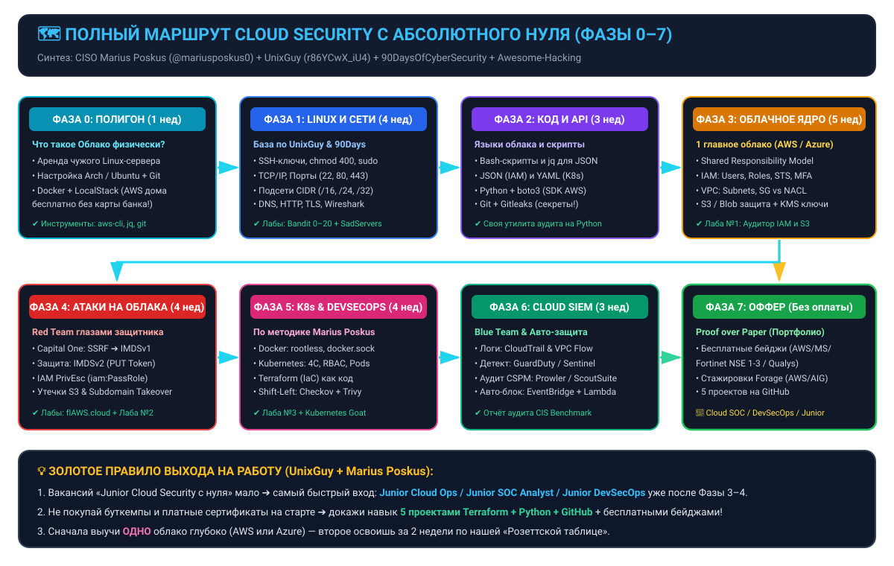
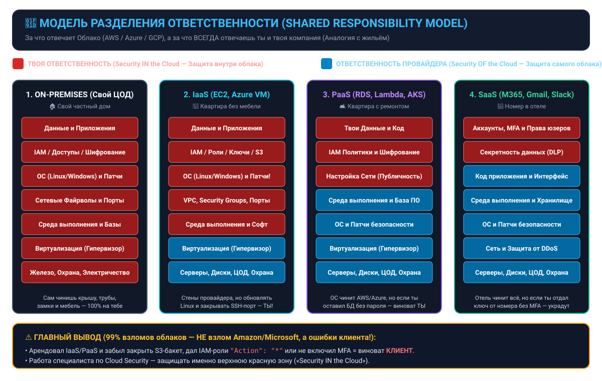
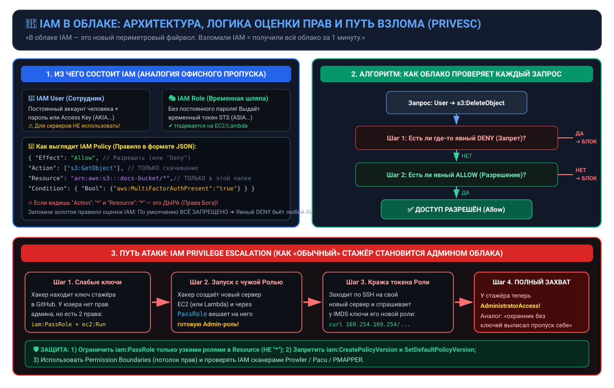
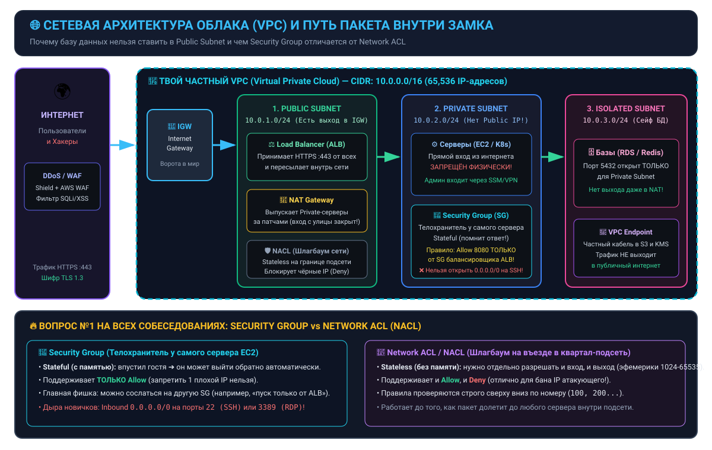
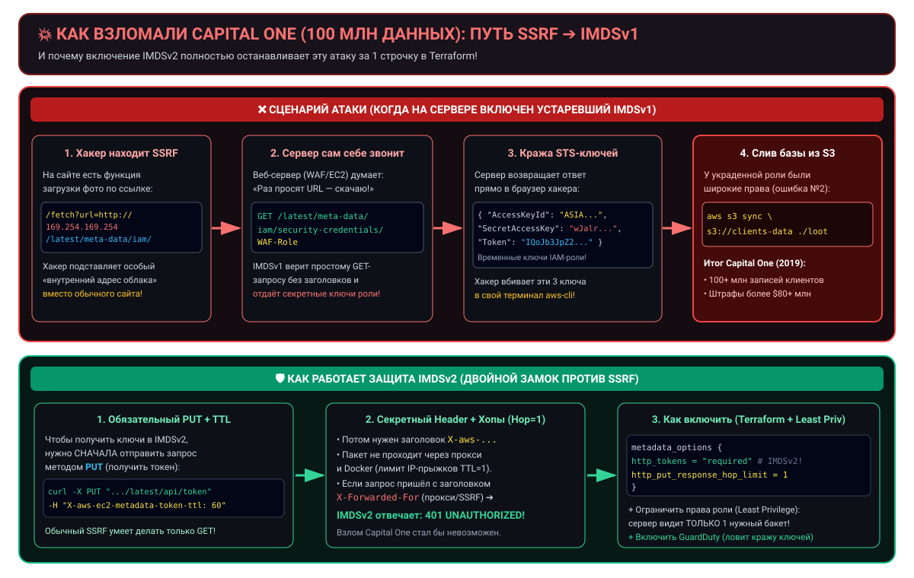
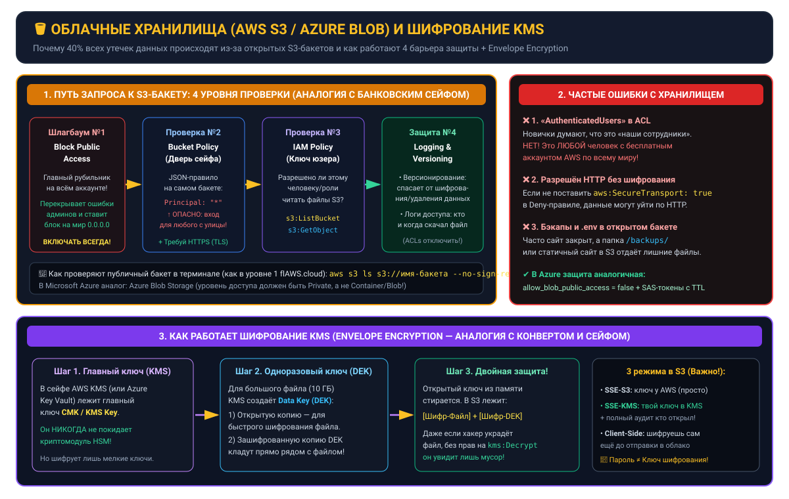
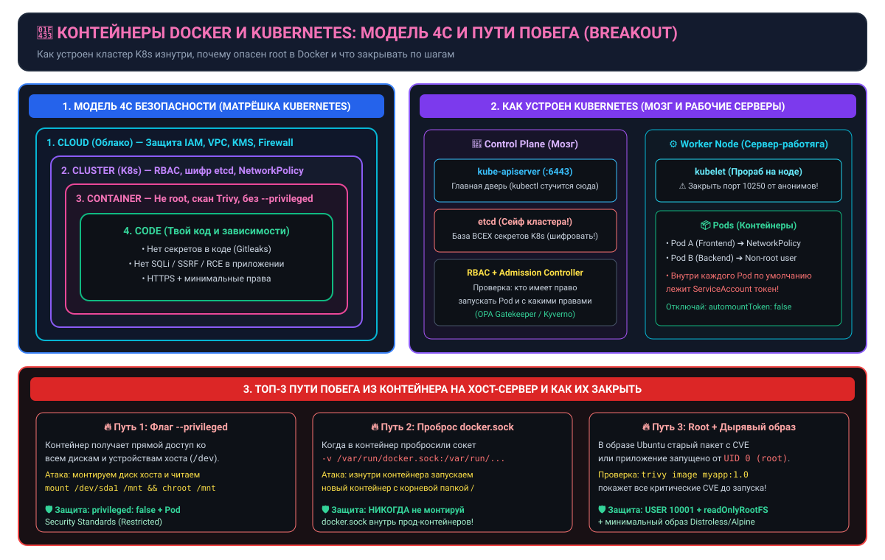
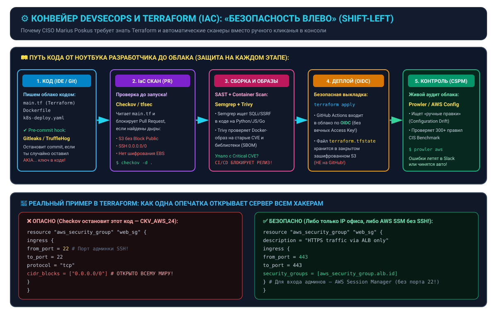
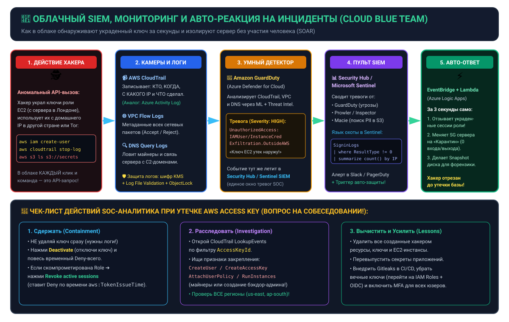
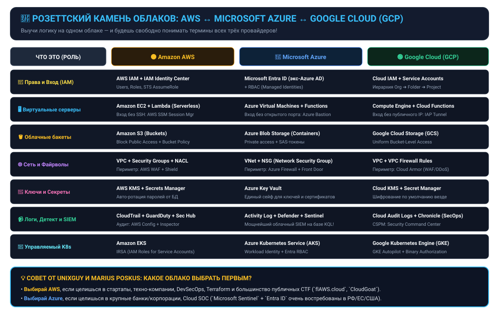
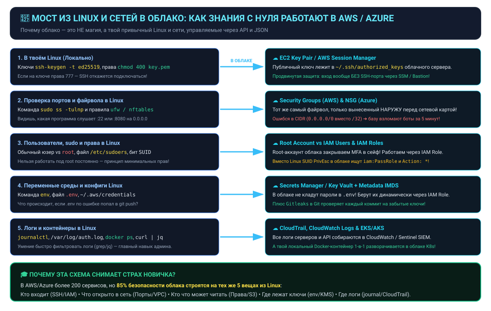
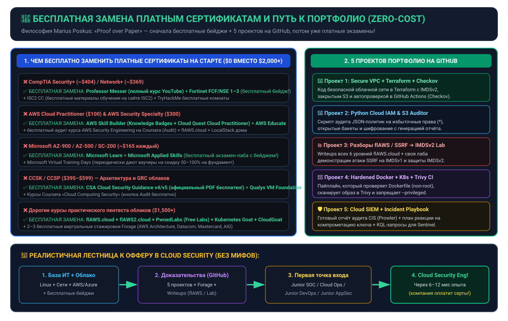
