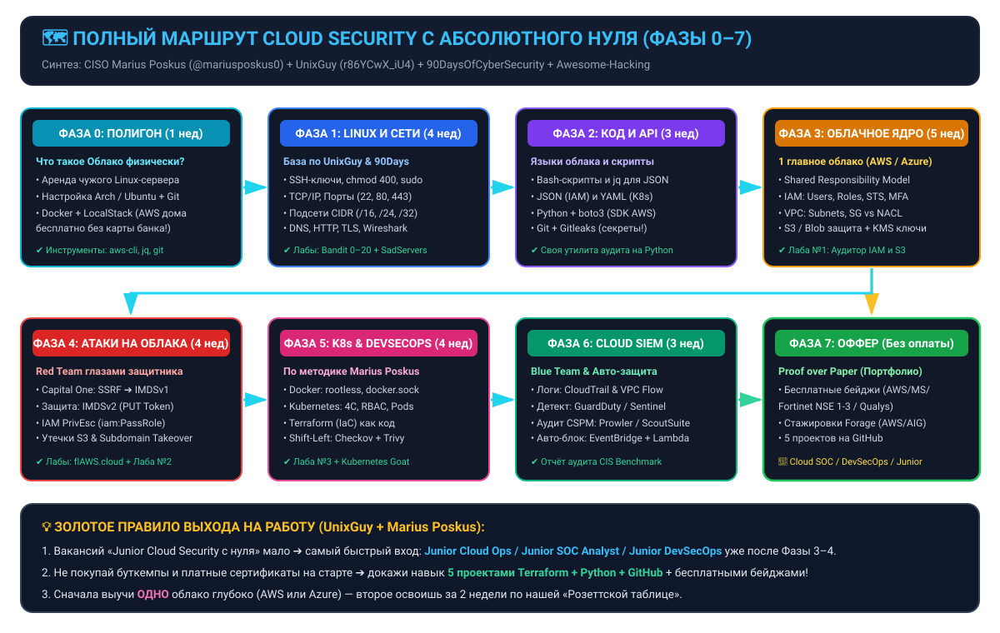
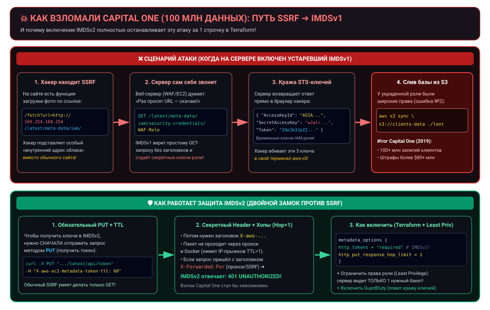
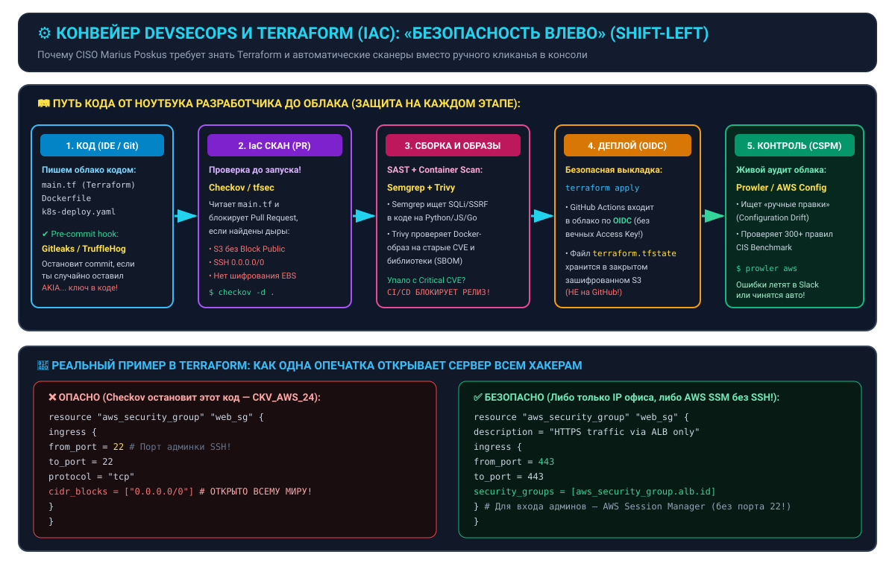

<div align="center">

# ☁️🛡️ Cloud Security Zero-to-Hero — Academy & Labs (`Core-37/Cloud-Security-37`)

**Полный открытый курс, интерактивный учебный сайт, 12 схем атак/защит, окно быстрых вспоминанок и локальные Python-лабы по безопасности облаков (AWS, Azure, Linux, Docker, Kubernetes, Terraform DevSecOps & Cloud SIEM) с абсолютного нуля.**


</div>

---

## 📋 Описание и теги для оформления шапки GitHub (About & Topics)

> Скопируй в настройки нового репозитория на GitHub (значок шестерёнки справа у **About**) — подробнее в [`GITHUB-INFO.md`](GITHUB-INFO.md):

- **Рекомендуемое название:** `Cloud-Security-37` *(уже привязано в локальном `origin`!)*
- **Description (EN, для международного HR и поиска):**
  `Zero-to-Hero Cloud Security Course & Interactive Academy (AWS, Azure, Linux, IAM, VPC, SSRF/IMDSv2, Docker/K8s, Terraform DevSecOps, Cloud SIEM). 12 visual SVG paths, 45+ flashcards, Python labs & $0 cert alternatives.`
- **Description (RU):**
  `Полный курс Cloud Security с нуля до портфолио: интерактивный сайт, окно вспоминанок (45+ карточек), 12 визуальных SVG-схем, разбор Capital One/flAWS, Terraform DevSecOps и 3 Python-лабы без оплаты.`
- **Topics:** `cloud-security`, `aws-security`, `azure-security`, `devsecops`, `terraform`, `kubernetes-security`, `iam`, `cybersecurity-roadmap`, `infosec`, `blue-team`, `cloud-pentesting`, `russian`

---

## 🌐 1. Интерактивный Учебный Сайт + Окно Маленьких Вспоминанок

Открой в любом браузере файл **[`08-Cloud-Academy-Site/index.html`](08-Cloud-Academy-Site/index.html)**:

- 🧭 **15 интерактивных разделов** (Фазы 0–7, синтез видео **Marius Poskus `@mariusposkus0`** + **UnixGuy `r86YCwX_iU4`** + **`90DaysOfCyberSecurity`** + **`Awesome-Hacking`**, все источники мира, банк аналогий, переводчик команд).
- 🧠 **Отдельное плавающее «Окно Маленьких Вспоминанок» (`Alt + M`)** — выдвигается поверх любого урока за 1 клик: **45 микро-карточек (за 5 секунд)**, фильтр по тегам, режим самопроверки `🙈 Скрыть ответы` и добавление **своих личных карточек**!
- ⇄ **Переключатель команд:** `Arch Linux` ↔ `Ubuntu` ↔ `AWS CLI` ↔ `Azure CLI`.
- ✅ **Трекер прогресса:** галочки сохраняются в браузере и повышают уровень (`L0` ➔ `L5`).

---

## 🖼️ 2. Визуальные Схемы и Пути Атаки / Защиты (12 SVG в [`05-Assets/`](05-Assets/05-Галерея-Схем-и-Путей.md))

### 🗺️ Полный маршрут обучения с нуля (Фазы 0–7)


### 💥 Разбор взлома Capital One (SSRF ➔ IMDSv1 `169.254.169.254`) и защита IMDSv2


### ⚙️ Конвейер DevSecOps & Terraform (Shift-Left: Gitleaks ➔ Checkov ➔ Trivy ➔ Prowler)


> Все **12 схем** (включая `Shared Responsibility`, `IAM PrivEsc`, `VPC (SG vs NACL)`, `S3 & KMS`, `Docker & Kubernetes 4C`, `Cloud SIEM & SOAR`, `Розеттский камень AWS/Azure/GCP`, `Мост Linux ➔ Облако` и `Замена сертификатов за $0`) собраны в **[Галерее схем](05-Assets/05-Галерея-Схем-и-Путей.md)**.

---

## 🗂️ 3. Карта Репозитория (Obsidian & GitHub)

| Папка | Содержание | Главные файлы |
| :--- | :--- | :--- |
| **`00-Roadmap/`** | Маршрут с нуля, разбор видео и замена платных экзаменов | [`Полный-Курс-Cloud-Security-С-Нуля.md`](00-Roadmap/Полный-Курс-Cloud-Security-С-Нуля.md) • [`Разбор-Видео-MariusPoskus-и-UnixGuy.md`](00-Roadmap/Разбор-Видео-MariusPoskus-и-UnixGuy.md) • [`Бесплатная-Замена-Сертификатов.md`](00-Roadmap/Бесплатная-Замена-Сертификатов.md) • [`Чек-лист-Прогресса-CloudSec.md`](00-Roadmap/Чек-лист-Прогресса-CloudSec.md) |
| **`01-Theory-Notes/`** | Подробные учебники с аналогиями и примерами из жизни | [`01-Linux-и-Сети-для-Облаков.md`](01-Theory-Notes/01-Linux-и-Сети-для-Облаков.md) • [`02-AWS-и-Azure-Фундамент-и-IAM.md`](01-Theory-Notes/02-AWS-и-Azure-Фундамент-и-IAM.md) • [`03-Атаки-на-Облака-и-Защита.md`](01-Theory-Notes/03-Атаки-на-Облака-и-Защита.md) • [`04-Docker-Kubernetes-Terraform-DevSecOps.md`](01-Theory-Notes/04-Docker-Kubernetes-Terraform-DevSecOps.md) |
| **`02-Labs/`** | Локальные Python-лабы (без карты банка) и гайд по LocalStack | [`README-Labs.md`](02-Labs/README-Labs.md) • [`lab01_s3_and_iam_auditor.py`](02-Labs/lab01_s3_and_iam_auditor.py) • [`lab02_ssrf_imds_simulator.py`](02-Labs/lab02_ssrf_imds_simulator.py) • [`lab03_terraform_sec_check.py`](02-Labs/lab03_terraform_sec_check.py) |
| **`03-Cheatsheets-and-Flashcards/`** | Шпаргалки и окно быстрых вспоминанок | [`Окно-Быстрых-Вспоминанок.md`](03-Cheatsheets-and-Flashcards/Окно-Быстрых-Вспоминанок.md) • [`Переводчик-Облаков-AWS-Azure-GCP-Linux.md`](03-Cheatsheets-and-Flashcards/Переводчик-Облаков-AWS-Azure-GCP-Linux.md) |
| **`04-Resources/`** | Университеты (MIT/Stanford/Coursera Audit), GitHub, Linux, статьи | [`Все-Проверенные-Источники-Мира.md`](04-Resources/Все-Проверенные-Источники-Мира.md) |
| **`05-Assets/`** | 12 детальных SVG-схем и путей атак/защит | [`05-Галерея-Схем-и-Путей.md`](05-Assets/05-Галерея-Схем-и-Путей.md) |
| **`06-Projects/`** | 5 проектов портфолио по системе Marius Poskus | [`06-5-Проектов-Портфолио-и-CTF.md`](06-Projects/06-5-Проектов-Портфолио-и-CTF.md) |
| **`07-Career-and-Resume/`** | Стажировки Forage, стратегия входа и шаблон резюме | [`07-Карьера-CloudSec-GRC-и-Шаблон-Резюме.md`](07-Career-and-Resume/07-Карьера-CloudSec-GRC-и-Шаблон-Резюме.md) |
| **`08-Cloud-Academy-Site/`** | Интерактивный веб-портал (HTML/CSS/JS) | [`index.html`](08-Cloud-Academy-Site/index.html) |

---

## 🧪 4. Быстрый запуск 3 практических Python-лабораторий

```bash
cd 02-Labs
python3 lab01_s3_and_iam_auditor.py     # Аудит IAM-политик (Action:*, PassRole) и S3
python3 lab02_ssrf_imds_simulator.py    # Симулятор взлома Capital One (SSRF -> IMDSv1) vs IMDSv2
python3 lab03_terraform_sec_check.py    # Мини-Checkov сканер sample_vulnerable_main.tf
```

---

## 👤 Автор и Связанный Репозиторий
- **Автор:** `Core-37` (g37)
- **Этот репозиторий (Cloud Security):** [`Core-37/Cloud-Security-37`](https://github.com/Core-37/Cloud-Security-37)
- **Первый репозиторий (AI/ML & AppSec Research Hub):** [`Core-37/Security37`](https://github.com/Core-37/Security37)
